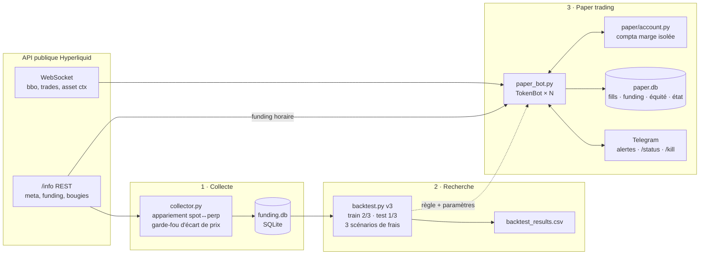

# funding-harvester

   

🇬🇧 [English version](README.md) · Projet lié : **[AlphaForge](https://github.com/theojoyerclement-crypto/alphaforge)**

Un **collecteur de funding en cash-and-carry sur Hyperliquid** : long spot + short perp de
même taille. La position est neutre au prix et touche le funding versé aux shorts. Le dépôt
couvre toute la chaîne, et le backtest a été rendu plus strict à chaque version :

1. **Collecteur** : API publique Hyperliquid → SQLite, relançable sans doublons.
2. **Backtest** en trois versions (v1 → v3), chacune corrige une illusion de la précédente.
3. **Bot de paper trading** : données WebSocket en direct, fills simulés, contrôle du risque,
   alertes Telegram, kill switch, déploiement systemd.

> **Aucun ordre réel n'est jamais envoyé.** Aucune clé API Hyperliquid n'est nécessaire ni
> utilisée. Rien ici n'est un conseil financier.

## Le résultat en une phrase

Hors échantillon (le dernier tiers de l'historique de chaque token, de 68 à 243 jours), la
règle unique *« en position tant que le funding moyen 72h est > 0 »* rapporte **+16 $ (taker)
à +25 $ (maker) sur 11 tokens × 80 USDC**, soit **≈ 4 à 6 %/an** du capital. Le gain est réel
mais modeste, et il vient presque entièrement de rares épisodes de funding élevé sur des
tokens spéculatifs.

## Architecture



| Module | Rôle |
|---|---|
| `hl_api.py` | Petit client de l'endpoint `/info` (relances, pagination, rate limit). |
| `collector.py` | Trouve les tokens qui ont un spot et un perp (tokens wrappés UBTC, LINK0, alias `UBONK → kBONK ×1000`) et rejette les homonymes dont le prix s'écarte de plus de 5 % du perp. Stocke le funding horaire et les bougies 1h/4h. |
| `storage.py` | Schéma SQLite. Les clés primaires rendent la collecte relançable. |
| `backtest.py` | Backtest v3 : règle unique, train/test par token, frais taker / mixte / maker, rééquilibrage, liquidation en marge isolée. |
| `paper/` | Logique du bot (`bot.py`), comptabilité (`account.py`), marché live (`market.py`), journal (`store.py`), Telegram (`notify.py`). |
| `paper_bot.py` | Point d'entrée : lancement, `--status`, `--kill`, `--resume`, `--reset`. |
| `deploy/` | Service systemd, script d'installation, modèle `.env`, guide VPS. |
| `config.py` | Tous les paramètres et frais, avec leur source (doc Hyperliquid, palier 0, vérifiée le 2026-11-04). |

## Backtest : v1 → v3

Chaque version répond à ce qui n'allait pas dans la précédente.

| | **v1** : grille | **v2** : hors échantillon | **v3** : règle unique, long historique |
|---|---|---|---|
| Historique | 90 jours | 90 jours (60 train / 30 test) | 205 à 730 jours par token (⅔ train / ⅓ test) |
| Tokens | 20 | 12 (filtre de liquidité) | 11 (filtre de liquidité + ≥ 90 jours) |
| Paramètres | 72 combinaisons par token (fenêtre × entrée × sortie × levier) | Même grille, choisie sur le train | **Aucun à optimiser** : en position si funding 72h > 0 |
| Frais | Taker + 0,05 % de slippage | Taker + 0,05 % de slippage | Taker / mixte / maker |
| Rééquilibrage | Aucun | Si hausse restante avant liquidation < 25 % | Idem |
| Liquidations | **66 à 263 sur 480** combinaisons selon le levier | 0 | 0 sur le test, 1 sur le train (PURR) |
| Résultat affiché | Top 5 = AZTEC, +41 à +55 %/an | **−0,38 $** au total sur le test | **+16 $ à +25 $** au total sur le test |
| Verdict | ❌ Pas crédible | ❌ Aucun avantage après frais | ✅ Faible mais positif hors échantillon |

**Pourquoi la v1 trompait.** Les « gains » d'AZTEC venaient surtout de l'écart de prix
spot/perp d'un spot illiquide (3,10 $ de funding sur 10,87 $). Les meilleurs des 72 réglages
étaient évalués sur les 90 jours qui avaient servi à les choisir. Et sans rééquilibrage, le
levier faisait liquider la plupart des combinaisons.

**Pourquoi la v2 ne trouvait rien.** Sur les 30 jours de test, le funding était au plancher de
Hyperliquid (≈ 11 %/an du notionnel). Un aller-retour taker coûte 0,43 % du notionnel, soit
environ un demi-mois de funding. Les réglages optimisés par token avaient collé au bruit. Le
seuil d'entrée à 10 % revenait à « toujours en position », puisque le plancher le dépasse déjà.

### Résultats v3 sur le test (funding net = funding reçu − tous les frais, 80 USDC par token, 2x)

| Token | Jours de test | Taker $ | Mixte $ | Maker $ | %/an (maker) | Rééquilibrages |
|---|---:|---:|---:|---:|---:|---:|
| PURR | 243 | 5,58 | 6,16 | 6,75 | 12,6 % | 38 |
| FARTCOIN | 181 | 3,07 | 3,29 | 3,51 | 8,8 % | 3 |
| HYPE | 233 | 2,40 | 2,66 | 2,92 | 5,7 % | 5 |
| PUMP | 159 | 1,77 | 2,00 | 2,24 | 6,4 % | 9 |
| XPL | 135 | 2,05 | 2,12 | 2,19 | 7,4 % | 1 |
| BTC | 213 | 0,74 | 1,24 | 1,76 | 3,8 % | 2 |
| ETH | 196 | −0,57 | 0,43 | 1,44 | 3,4 % | 3 |
| ZEC | 80 | 1,27 | 1,35 | 1,42 | 8,1 % | 8 |
| MON | 115 | 0,35 | 0,83 | 1,32 | 5,2 % | 5 |
| SOL | 181 | −0,98 | −0,06 | 0,87 | 2,2 % | 3 |
| VIRTUAL | 68 | 0,38 | 0,62 | 0,86 | 5,7 % | 4 |

| Scénario | Net train $ | **Net test $** | Frais test $ | %/an moyen (test) | Test, une seule entrée $ |
|---|---:|---:|---:|---:|---:|
| Taker (spot 0,070 % + perp 0,045 %, + 0,05 % de slippage par jambe) | 34,57 | **16,05** | 13,16 | 4,0 % | 4,21 |
| Mixte (spot maker 0,040 %, perp taker + slippage) | 44,69 | **20,64** | 8,68 | 5,1 % | 5,07 |
| Maker (spot 0,040 % + perp 0,015 %, sans slippage) | 54,94 | **25,27** | 4,16 | 6,3 % | 5,94 |

**Ce que disent les chiffres**
- **Le funding est concentré.** Les jours au-dessus de 25 %/an ne font que 11,8 % des jours
  (642 sur 5418), mais apportent 82 % du funding de PURR, 59 % de celui de HYPE et 49 % de
  celui de FARTCOIN.
- **BTC, ETH et SOL ne touchent que le taux de base** (2 à 3 % de jours élevés). En taker,
  ils sont à l'équilibre ou négatifs.
- **L'exécution compte plus que les paramètres.** Passer des frais taker aux frais maker
  ajoute environ 60 % au résultat.
- **Ne jamais revenir après une première sortie** (« une seule entrée ») est bien pire : la
  plus grande partie du funding arrive après.

### Limites (à lire avant de croire un chiffre)
- **Les mèches sont invisibles.** La liquidation est testée sur les clôtures : en 1h sur les
  ~208 derniers jours, **en 4h avant** (l'API ne garde que 5000 bougies par intervalle). La
  majeure partie du train tourne donc sur des prix 4h.
- **Une liquidation sur le train :** PURR a pris +38 % en une seule bougie 4h (12/12/2024).
  Un rééquilibrage vérifié seulement aux clôtures arrive trop tard, même à 1x. Un bot qui
  surveille en continu aurait sans doute rééquilibré, mais rien n'est garanti sur un saut
  pareil.
- **Le maker est un plafond optimiste :** sans slippage, sans risque de non-exécution, sans
  fill partiel. Le scénario **mixte** est le plus réaliste, et c'est celui que le bot applique.
- **Un seul régime de marché par token.** Le test est une période continue unique.
- **Petit échantillon.** 11 tokens. 9 autres sont exclus pour manque de liquidité (LINK de
  justesse : 89,4 % pour un seuil de 90 %).
- **Anomalie sur le train BTC :** les premières bougies spot UBTC ont un prix fictif
  (≈ 6,97 M$). La colonne `gain` (valorisation) du train BTC dans `backtest_results.csv` est
  donc faussée. Le chiffre retenu ici est la colonne `net` (funding − frais), mais la taille
  des positions BTC sur cette fenêtre en est aussi affectée. La période de **test** BTC est
  propre.
- Frais au palier 0, sans réduction staking HYPE. Marge de maintenance approchée par
  1 / (2 × levier max).

## Bot de paper trading

Le bot applique la règle v3 sur **HYPE + FARTCOIN, 40 USDC chacun, levier 2x**, dans le
scénario d'exécution *mixte*, contre le carnet d'ordres Hyperliquid en direct.

- **Entrée :** achat spot maker au meilleur bid, repositionné après 30 s si le prix s'éloigne.
  L'ordre n'est rempli que si le marché **passe à travers** le prix ; un simple contact ne
  suffit pas, à cause de la file d'attente. Le short perp taker couvre ensuite tout de suite.
- **Sortie :** vente spot maker, puis rachat du perp en taker. Si l'ordre n'est pas rempli en
  15 min, sortie en taker.
- **Contrôle du risque chaque minute :** si la hausse restante avant liquidation passe sous
  25 %, le bot vend du spot, rachète la même taille de perp et met le cash libéré en marge
  (retour à 2x).
- **Une jambe sans l'autre :** le bot retente la couverture chaque seconde, annule la 1re
  jambe après 30 s, et déclenche le kill switch du token après 2 min. Un fill taker n'est
  jamais simulé sur des prix de plus de 10 s.
- **Funding :** photo de la taille du short et du prix oracle à chaque heure pleine, puis
  crédit du taux officiel lu sur l'API. Un paiement n'est jamais compté deux fois, même après
  un redémarrage.
- **Kill switch :** Telegram `/kill`, `python paper_bot.py --kill`, un fichier `KILL`, ou
  automatique (perte totale > 10 %, liquidation, jambe non couverte). Il ferme tout en taker
  et reste actif après redémarrage, jusqu'à `--resume`.
- **Journal (`paper.db`) :** chaque fill (maker/taker, frais), chaque paiement de funding, les
  événements, une photo de l'équité toutes les 5 min, l'état courant.
- **Exploitation :** service systemd avec redémarrage automatique, arrêt propre sur SIGTERM et
  écriture limitée à son dossier. Voir [`deploy/README.md`](deploy/README.md).

Testé 2 min 30 sur le flux réel : les deux jambes ont été exécutées et couvertes dans la même
seconde (HYPE) ou après un repositionnement (FARTCOIN), avec une liquidation à +43 % de
l'entrée.

## Tests

```bash
python -m pytest tests -q
```

Les 11 tests hors ligne tournent sur un marché simulé, sans réseau. Ils couvrent les fills
maker (contact ≠ fill), la couverture perp, l'échec de couverture suivi de l'annulation du
spot, le kill switch sur une jambe impossible à couvrir, le rééquilibrage qui rétablit la
marge tout en restant neutre, la comptabilité du PnL à la sortie, le funding crédité une seule
fois, la persistance kill/resume, le kill sur perte globale, l'absence de faux kill sans prix
et la protection contre les prix périmés.

## Lancement

```bash
git clone https://github.com/theojoyerclement-crypto/funding-harvester.git
cd funding-harvester
python -m venv .venv && source .venv/bin/activate   # Windows : .venv\Scripts\activate
pip install -r requirements.txt

python collector.py      # construit funding.db depuis l'API publique (quelques minutes, relançable)
python backtest.py       # backtest v3 -> tableaux en console + backtest_results.csv
python -m pytest tests -q

python paper_bot.py      # paper trading (Ctrl+C pour arrêter, l'état est sauvé)
python paper_bot.py --status
```

Les alertes Telegram sont optionnelles : copier `deploy/env.example` en `.env` et renseigner
`TELEGRAM_BOT_TOKEN` et `TELEGRAM_CHAT_ID`. Sans elles, les alertes vont seulement dans le
log. `.env` et tous les fichiers `*.db` sont exclus de git.

Déploiement sur VPS (Debian/Ubuntu) : `sudo bash deploy/install.sh`. Voir
[`deploy/README.md`](deploy/README.md).

## Projet lié : AlphaForge

**[AlphaForge](https://github.com/theojoyerclement-crypto/alphaforge)** est mon framework de
recherche quant crypto plus large : features sans fuite d'information, contrôle des tests
multiples, backtests qui comptent les coûts, et paper trading sur le même code.
funding-harvester applique la même discipline (test hors échantillon, frais explicites,
limites publiées) à une source de rendement précise et structurelle : le funding des perps.

---

Sous [licence MIT](LICENSE).
