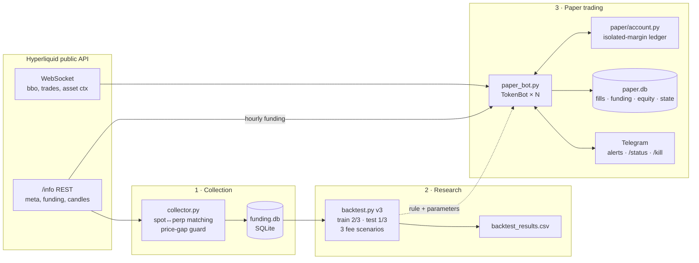

# funding-harvester

  

🇫🇷 [Version française](README.fr.md) · Related project: **[AlphaForge](https://github.com/theojoyerclement-crypto/alphaforge)**

A **cash-and-carry funding-rate harvester for Hyperliquid**: long spot plus short perp
in the same size, so the position is price-neutral and collects the perp funding paid to
shorts. The repository covers the whole path, with the backtest tightened at each version:

1. **Collector**: public Hyperliquid API to SQLite, rerunnable with no duplicates.
2. **Backtest** in three versions (v1 → v3), each removing an illusion from the previous one.
3. **Paper-trading bot**: live WebSocket data, simulated fills, risk checks, Telegram
   alerts, kill switch, systemd deployment.

> **No real orders are ever sent.** No Hyperliquid API key is needed or used anywhere.
> Nothing here is financial advice.

## Key result in one sentence

On out-of-sample data (the last third of each token's history, 68 to 243 days), the single
rule *"be in position while the 72h average funding is > 0"* earned **+16 $ (taker) to +25 $
(maker) across 11 tokens × 80 USDC**, i.e. **≈ 4–6 % a year** on capital. It is real but
modest, and almost all of it comes from rare high-funding episodes on speculative tokens.

## How it works



| Module | Role |
|---|---|
| `hl_api.py` | Thin client for Hyperliquid's `/info` endpoint (retries, pagination, rate limit). |
| `collector.py` | Finds every token with both a spot and a perp market (wrapped tokens such as UBTC, LINK0 and aliases such as `UBONK → kBONK ×1000`) and rejects same-name impostors whose price is more than 5 % off the perp. Stores hourly funding plus 1h/4h candles. |
| `storage.py` | SQLite schema. Primary keys make reruns idempotent. |
| `backtest.py` | v3 backtest: one rule, per-token train/test split, taker / mixed / maker fees, rebalancing, isolated-margin liquidation. |
| `paper/` | Bot logic (`bot.py`), ledger (`account.py`), live market data (`market.py`), journal (`store.py`), Telegram (`notify.py`). |
| `paper_bot.py` | Entry point: run, `--status`, `--kill`, `--resume`, `--reset`. |
| `deploy/` | systemd unit, install script, `.env` template, VPS guide. |
| `config.py` | Every parameter and fee, with its source (Hyperliquid docs, tier 0, checked 2026-11-04). |

## Backtest: v1 → v3

Each version was driven by what was wrong with the previous one.

| | **v1**: grid search | **v2**: out-of-sample | **v3**: single rule, long history |
|---|---|---|---|
| History | 90 days | 90 days (60 train / 30 test) | 205–730 days per token (⅔ train / ⅓ test) |
| Tokens | 20 | 12 (liquidity filter) | 11 (liquidity filter + ≥ 90 days) |
| Parameters | 72 combos per token (window × entry × exit × leverage) | Same grid, chosen on train | **None to optimise**: in if 72h funding > 0 |
| Fees | Taker + 0.05 % slippage | Taker + 0.05 % slippage | Taker / mixed / maker |
| Rebalancing | None | When < 25 % move left before liquidation | Same |
| Liquidations | **66–263 of 480** combos per leverage | 0 | 0 on test, 1 on train (PURR) |
| Headline | Top 5 all AZTEC, +41 to +55 %/yr | **−0.38 $** total on test | **+16 $ to +25 $** total on test |
| Verdict | ❌ Not credible | ❌ No edge after fees | ✅ Small but positive out of sample |

**Why v1 was misleading.** AZTEC's "gains" mostly came from spot/perp price gaps on an
illiquid spot (only 3.10 $ of 10.87 $ was funding). Best-of-72 settings were evaluated on the
same 90 days used to pick them, and without rebalancing, leverage got most combinations
liquidated.

**Why v2 found nothing.** Over the 30-day test, funding sat at Hyperliquid's floor
(≈ 11 %/yr of notional), while a taker round trip costs 0.43 % of notional, about half a
month of funding. Settings tuned per token had fitted noise. The 10 % entry threshold meant
"always in", because the floor already exceeds it.

### v3 test results (net funding = funding received − all fees, on 80 USDC per token, 2x)

| Token | Test days | Taker $ | Mixed $ | Maker $ | %/yr (maker) | Rebalances |
|---|---:|---:|---:|---:|---:|---:|
| PURR | 243 | 5.58 | 6.16 | 6.75 | 12.6 % | 38 |
| FARTCOIN | 181 | 3.07 | 3.29 | 3.51 | 8.8 % | 3 |
| HYPE | 233 | 2.40 | 2.66 | 2.92 | 5.7 % | 5 |
| PUMP | 159 | 1.77 | 2.00 | 2.24 | 6.4 % | 9 |
| XPL | 135 | 2.05 | 2.12 | 2.19 | 7.4 % | 1 |
| BTC | 213 | 0.74 | 1.24 | 1.76 | 3.8 % | 2 |
| ETH | 196 | −0.57 | 0.43 | 1.44 | 3.4 % | 3 |
| ZEC | 80 | 1.27 | 1.35 | 1.42 | 8.1 % | 8 |
| MON | 115 | 0.35 | 0.83 | 1.32 | 5.2 % | 5 |
| SOL | 181 | −0.98 | −0.06 | 0.87 | 2.2 % | 3 |
| VIRTUAL | 68 | 0.38 | 0.62 | 0.86 | 5.7 % | 4 |

| Scenario | Net train $ | **Net test $** | Fees test $ | Mean %/yr (test) | Test, single entry only $ |
|---|---:|---:|---:|---:|---:|
| Taker (spot 0.070 % + perp 0.045 %, + 0.05 % slippage per leg) | 34.57 | **16.05** | 13.16 | 4.0 % | 4.21 |
| Mixed (spot maker 0.040 %, perp taker + slippage) | 44.69 | **20.64** | 8.68 | 5.1 % | 5.07 |
| Maker (spot 0.040 % + perp 0.015 %, no slippage) | 54.94 | **25.27** | 4.16 | 6.3 % | 5.94 |

**What the numbers say**
- **Funding is concentrated.** Days with funding above 25 %/yr are only 11.8 % of all days
  (642 / 5418) but bring 82 % of PURR's funding, 59 % of HYPE's and 49 % of FARTCOIN's.
- **BTC, ETH and SOL earn only the base rate** (2–3 % of days are high-funding). They are
  break-even or negative with taker fees.
- **Execution matters more than parameters.** Going from taker to maker fees adds ~60 % to
  the result.
- **Never re-entering after the first exit** ("single entry only") is much worse: most of the
  funding arrives later.

### Limitations (read before trusting any number)
- **Wicks are invisible.** Liquidation is tested on candle closes: 1h for the last ~208 days,
  **4h before that** (the API keeps only 5,000 candles per interval). Most of the train set is
  therefore on 4h prices.
- **One train-set liquidation:** PURR rose +38 % in a single 4h candle (2024-12-12). A
  rebalance checked only at closes came too late even at 1x. A bot watching continuously
  would probably have rebalanced, but nothing is guaranteed on a jump like that.
- **Maker is an optimistic ceiling:** no slippage, no non-fill risk, no partial fills.
  **Mixed** is the realistic scenario and the one the bot implements.
- **One market regime per token.** The test is a single contiguous period.
- **Small sample.** 11 tokens, and 9 more were excluded for illiquidity (LINK was just under the
  threshold, 89.4 % vs 90 %).
- **BTC train data quirk:** early UBTC spot candles carry placeholder prices (≈ 6.97 M$),
  which breaks the mark-to-market `gain` column on BTC's train set in
  `backtest_results.csv`. The `net` column (funding − fees) is the metric reported here, but
  BTC train position sizes in that window are also affected. The BTC **test** period is clean.
- Fees are tier 0 with no HYPE staking discount. Maintenance margin is approximated as
  1 / (2 × max leverage).

## Paper-trading bot

The bot implements the v3 rule on **HYPE + FARTCOIN, 40 USDC each, 2x**, in the *mixed*
execution scenario, against the live Hyperliquid order book.

- **Entry:** maker spot buy at best bid, re-quoted after 30 s if the market moves away. It
  fills only if the market **trades through** the price; a touch doesn't count, because of
  queue position. Then a taker perp short hedges it immediately.
- **Exit:** maker spot sell, then a taker perp buy-back. After 15 min unfilled, it exits taker.
- **Risk check every minute:** if less than a 25 % move is left before liquidation, it sells
  spot, buys back the same perp size, and moves the freed cash to margin (back to 2x).
- **One leg without the other:** it retries the hedge every second, unwinds the first leg
  after 30 s, and triggers a token kill switch after 2 min. A taker fill is never simulated
  on prices older than 10 s.
- **Funding:** it snapshots short size and oracle price at each full hour, then credits the
  official rate read from the API. A payment is never counted twice, even across restarts.
- **Kill switch:** Telegram `/kill`, `python paper_bot.py --kill`, a `KILL` file, or
  automatic (total loss > 10 %, liquidation, unhedged leg). It closes everything with taker
  orders and persists across restarts until `--resume`.
- **Journal (`paper.db`):** every fill (maker/taker, fees), every funding payment, events,
  equity snapshots every 5 min, current state.
- **Ops:** a systemd service with auto-restart, clean SIGTERM shutdown and a sandboxed write
  path. See [`deploy/README.md`](deploy/README.md) (in French).

Tested live for 2.5 min on the real feed: both legs filled and hedged within the same second
(HYPE) or after one re-quote (FARTCOIN), with liquidation at +43 % from entry.

## Tests

```bash
python -m pytest tests -q
```

The 11 offline tests use a simulated market, with no network. They cover maker fills
(touch ≠ fill), the perp hedge, a failed hedge followed by unwinding the spot leg, a kill
switch on an unhedgeable leg, rebalancing that restores the liquidation buffer while staying
delta-neutral, exit PnL accounting, funding credited exactly once, kill/resume persistence,
the global-loss kill, no false kill without prices, and stale-price protection.

## Getting started

```bash
git clone https://github.com/theojoyerclement-crypto/funding-harvester.git
cd funding-harvester
python -m venv .venv && source .venv/bin/activate   # Windows: .venv\Scripts\activate
pip install -r requirements.txt

python collector.py      # builds funding.db from the public API (a few minutes, rerunnable)
python backtest.py       # v3 backtest -> console tables + backtest_results.csv
python -m pytest tests -q

python paper_bot.py      # paper trading (Ctrl+C to stop; state is saved)
python paper_bot.py --status
```

Telegram alerts are optional: copy `deploy/env.example` to `.env` and fill in
`TELEGRAM_BOT_TOKEN` and `TELEGRAM_CHAT_ID`. Without them, alerts only go to the log.
`.env` and every `*.db` file are git-ignored.

VPS deployment (Debian/Ubuntu): `sudo bash deploy/install.sh`. See
[`deploy/README.md`](deploy/README.md).

## Related: AlphaForge

**[AlphaForge](https://github.com/theojoyerclement-crypto/alphaforge)** is my broader crypto
quant research framework: leak-free features, multiple-testing controls, cost-aware
backtests, and paper trading on the same code path. funding-harvester applies the same
discipline (out-of-sample testing, explicit fees, published limitations) to one specific,
structural source of return: perp funding.

---

Code comments and console output are in French.
